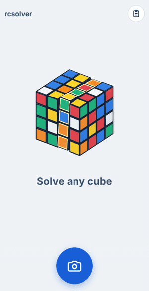

# rcsolver

**▶ 立刻用手機玩：<https://rcsolver.yanglassnake.workers.dev/>**

手機網頁版魔術方塊求解器（2x2～7x7）：引導拍攝六面 → Claude 辨色 → 核對修正 → 瀏覽器求解 → 3D 動畫引導。

<p align="center"></p>

目前進度：**2×2 到 7×7 完整流程可用**（拍攝引導 → 辨色 → 核對修正 → 求解 → 3D 動畫逐步引導）。求解器都在瀏覽器裡跑：2×2 用 IDA*，3×3 用 min2phase，4×4 到 7×7 用 reduction（中心 → 翼塊配對 → parity → 當 3×3 解），解出來的步驟一律先在內部模型重播確認能復原。步數大約：4×4 120、5×5 280、6×6 480、7×7 750。規劃與待辦見 [docs/PLAN.md](docs/PLAN.md)。

核對修正：辨識結果畫面按扳手打開展開圖，點一面放大，背景是那一面的照片；下方一排六色，先選一個顏色，再連續點要改成這個顏色的格子。如果 AI 那一端失敗（服務忙碌、被拒絕、回覆格式不對），不再只顯示錯誤：會跳出選方塊大小，接著進入全灰的展開圖，照著照片自己填色，每格都填完才能求解；同一個視窗也可以「再試一次 AI」。照片裡看不到方塊時仍然標出那幾張請使用者重拍。

解題畫面有**導覽模式**（按方塊右上角的「?」開啟，預設關閉）：上方的階段籤（中心 → 邊塊 → 特殊修正 → 3×3）顯示目前進度，點一下可跳到那一段；方塊上只有這一段在處理的格子保留顏色，其他變成灰色；並有一小段文字說明這一段的策略。

3×3 另有**教學模式**：核對畫面 Go 旁邊的畢業帽按鈕。用初學者的層先法一層一層解（底層十字 → 底層角 → 中層邊 → 頂層十字 → 頂面全黃 → 角塊歸位 → 邊塊歸位，約 170 步），每一塊都有說明：它在哪、為什麼先轉那幾步、用哪條公式，公式可以按一下重看。分享連結會記住是教學解。

**研究模式**：首頁拍照鈕右邊的燒瓶，選 2×2～7×7，從復原的方塊開始輸入轉法：按鍵盤一排順時針、一排逆時針，最後一排是 x y z 和刪除；連按同一層會自動合併（L L → L2、再按 L → L′、再按一次就抵消消失，L 接 L′ 也會抵消），在文字框自己打的不會合併；按住轉動鍵不放，方塊上會標出那幾層和轉動方向但不轉，放開也不轉，只有點一下才轉；點方塊上任何一格會加上黑點記號，不管怎麼轉都跟著那一格走，再點一次取消（進入研究模式時會先在前面正中央點一個（偶數階點在中央四格的左上），而且不管從哪裡進來（含打開存檔）都從原始角度開始；離開研究模式就清掉，存檔不保留）；也可以直接編輯文字，看不懂的記號會跳過、文字框變紅。改到上一步時方塊會從原本的位置轉過去，不會瞬間跳；方塊右上的「?」每按一下只亮一組塊（中心、邊塊、角塊…），上方附上和導覽模式同樣口吻的說明。沿用解題畫面播放，也能存檔（首頁卡片有燒瓶，點回來是同樣的轉法和步數）。按 Go 把畫面上的狀態交給求解器進入解題；解題畫面的燒瓶把當下那一步的方塊帶到研究模式，這時右上多一顆返回鈕，回到原本的解法和那一步（研究中輸入的轉法不保留）。首頁的存檔卡片沒有分享鈕，分享在點進去的解題畫面。方塊左下的「手轉」開關打開後，從某一格開始拖曳會轉那一層：那層跟著手指轉，放手吸到最近的 90°（不到一半就彈回），轉完記成一步（和按鍵一樣會合併），在較早的步數時先跳到最後一步；關掉時拖曳照舊轉視角，點一下照舊是加記號；開關記在這支手機上。右上存檔鍵左邊的 ⓘ 是逐步導覽：畫面變暗，一次只亮一個區域（方塊、鍵盤、文字框、播放、Go、存檔）並附說明（`web/src/tour.ts`）。純邏輯在 `web/src/study.ts`。

**回到首頁**：右上的 Home 鍵在離開會丟掉東西時先跳確認框（拍到一半的照片、辨識結果、沒存檔的解題或研究）；剛存過或剛打開又沒動、研究還沒輸入任何轉法時直接回首頁。

文字跟著手機的語言：第一語言是中文的裝置顯示繁體中文，其他一律英文。範圍包含教學和導覽的說明、錯誤訊息，以及按鈕給螢幕閱讀器念的名稱（`web/src/i18n.ts`）；解題在背景執行緒裡寫說明，語言由頁面一起傳過去。

大方塊的中心查表（`web/tables/`，全部約 0.8 MB）是離線算好的，頁面在需要時才抓對應尺寸的那幾個檔；抓不到就在瀏覽器裡現算。產生器：`npm run gen:macros`（4×4 翼塊 3-循環公式庫）、`npm run gen:centre-macros 5`（某尺寸的中心公式庫）、`npm run gen:tables`（所有中心查表）。改了中心求解的走法集合後要重跑 `gen:tables`，測試會提醒。

## 安裝成 app

網站可以加到手機主畫面，名稱「Cube方塊」，打開時全螢幕：iPhone 用 Safari 的分享 →「加入主畫面」，Android 的 Chrome 會出現「安裝應用程式」。設定在 `web/manifest.webmanifest`，圖示原稿是 `web/icons/icon.svg`（Android 圓形裁切用的是方塊縮小的 `icon-maskable.svg`），PNG 是從 SVG 輸出的 180／192／512px。iPhone 上從主畫面打開的版本和 Safari 的存檔是分開的。

**離線也能用**：第一次有網路打開後，`sw.js`（service worker）會在背景把網頁和 4×4～7×7 的求解表（合計約 1.4 MB）存在手機上，之後沒網路也能打開、拍照、手動填色、求解、研究和開分享連結；只有 AI 辨色需要網路，離線時按 Go 會直接改成自己填色。網頁本身每次先向網站拿最新版（4 秒拿不到才用存著的），其他檔案檔名帶版本號，所以有網路時永遠是最新版。`scripts/stamp.mjs` 在建置時把要存的檔案清單和版本號寫進 `public/sw.js`，版本一變，手機就換一份新的、刪掉舊的。

## 本機執行

```bash
npm install
cp .env.example .env        # 填 RCSOLVER_ANTHROPIC_KEY；留空就是 MOCK 模式
npm run dev                 # http://localhost:3000
npm test
```

手機要開相機必須走 https（或 localhost），所以用手機實測最簡單的方式就是部署上去。

## 部署到 Cloudflare（設定一次，之後推 main 就自動部署）

1. 到 Cloudflare dashboard → Workers & Pages → Create → 選「Import a repository」，連結 GitHub 的 `rcsolver`，分支選 `main`。
   建置設定保持預設（deploy command 是 `npx wrangler deploy`，前端會在部署時自動打包）。
2. 建好後到這個 Worker 的 Settings → Variables and Secrets，新增 Secret `RCSOLVER_ANTHROPIC_KEY`，貼上專用金鑰。
3. 網址是 `https://rcsolver.<你的帳號>.workers.dev`，已經是 https，手機直接開就能用相機。
   之後每次推到 main，Cloudflare 會自己重新部署；dashboard 的 Logs 看得到每次辨識的 token 用量。

不想連 GitHub 也可以手動：`npx wrangler login`、`npx wrangler secret put RCSOLVER_ANTHROPIC_KEY`、`npm run cf:deploy`。

每日額度（`DAILY_LIMIT`）預設每個 Worker isolate 各算一份，只是粗略的保險；要全站精確共用，建一個 KV namespace 綁到 `QUOTA`（`wrangler.toml` 有範例）。模型、effort、限流都在 `wrangler.toml` 的 `[vars]` 改，改完推上去就生效。

也能跑在任何 Node 主機（Render、Fly）：`npm run build && npm start`，記得設 `TRUST_PROXY=1`。

## 分享狀態

辨識畫面的複製鈕會複製 Kociemba 格式的 facelet 字串：面的順序 U R F D L B，每面逐列，每格一個字母代表這張貼紙屬於哪一面（3×3 復原狀態是 `UUUUUUUUURRRRRRRRRFFFFFFFFFDDDDDDDDDLLLLLLLLLBBBBBBBBB`）。奇數階以中心決定面，偶數階以 DBL 角決定。首頁的貼上鈕可以匯入這種字串（也接受 W Y R O G B 顏色字母）直接重現狀態。

解題畫面的儲存鈕把初始狀態、解法和進度存在瀏覽器裡（不限筆數），首頁列出縮圖可以點回去繼續，縮圖下的標題預設是存檔時間，點一下可以改名。分享鈕（辨識結果、解題、研究畫面都有）複製一個短連結 `#z=<token>`，分享的是畫面上那一步的方塊本身，不帶任何轉法；對方打開**一律是全新的研究模式**（沒有轉法、從這個方塊開始），要解自己按 Go。token 是 base64url，內含尺寸和每 3 格一個位元組的貼紙顏色。舊連結仍可開啟，一樣變成全新的研究模式：帶步數的舊連結先把方塊轉到那一步（帶轉法的照轉，舊的解題連結用確定性的求解器重算），舊格式 `#s=<facelets>&m=<轉法>&i=<步數>` 也是。第一次進研究模式會自動跑一次 ⓘ 的導覽。

## 端點

| 方法 | 路徑 | 說明 |
|---|---|---|
| GET | `/api/health` | 模式、模型、今日用量 |
| POST | `/api/recognize` | `{ size, faces: { U,R,F,D,L,B: { mediaType, data(base64) } } }` → 每面 N 列顏色字母、每格信心 0–9、顏色數量警告、token 用量 |

照片只在記憶體中轉交給模型，不落地、不記 log。

## 拍攝順序與展開圖方向

前 → 右 → 後 → 左（每次整顆向左轉 90°，上面不動）→ 拍完左面直接向下翻 90° 拍上面 → 向上翻 180° 拍底面。每張側面照的上方都是 U；上面照的上方是 R、底面照的上方是 L，這兩張在拍下時就各轉 90°（上面順時針、底面逆時針），存下來的照片都和標準展開圖同方向。
